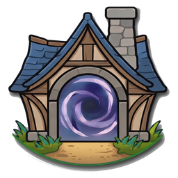

  

<h1 align="center">Commonhold</h1>

  <b>An open protocol for player-run worlds.</b> 
  Run your own world. Play with everyone. Keep your character forever.

  <a href="https://orionopenwow.github.io/Commonhold/">Console</a> ·
  <a href="wiki/Home.md">Wiki</a> ·
  <a href="spec/README.md">Spec</a> ·
  <a href="CREDITS.md">Credits</a> ·
  <a href="#join-the-build">Join the build</a>

<!-- ch:pulse:start -->
Day **0** · **4** members · spec 0/8 sections accepted · 0/9 milestones done · updated 2026-11-10
<!-- ch:pulse:end -->

## The gist

Servers shut down and take years of characters with them. Playing alone on your own server is safe but lonely.
Commonhold is the way between: **everyone keeps their own world, and the worlds are connected.**

- **It's a protocol, not an app.** This repo holds the spec, the shared decisions and each builder's work. There is
  no Commonhold program to download, and there doesn't need to be one: launchers and server modules implement it.
- **Nobody owns it.** The first apps speaking it are Leyline, Worlds of CoreCraft and Project Eternal, and each
  keeps its own name. Anyone can build another.
- **Only signed records travel.** No game files, no money, no accounts to make: a key is your identity, and every
  listing, passport and visit is signed so anyone can check it.

## What the protocol does

| | |
|---|---|
| 🔑 **One identity** | One key per player, kept on your own PC. A different key per world you visit, so nobody can track you across them. |
| 🗺️ **Realm cards** | Every world publishes a signed card: its version, rules, mods and what it accepts. Lists rank by published criteria, never by money. |
| 🤝 **Live together** | Stay on your own server and play live with linked servers: parties, chat and trade across worlds. |
| 🧳 **Visits** | Take your character to a friend's world and bring it home. Your home keeps the original; the host only proposes what changed, and you approve it. |
| 🛡️ **Unkillable characters** | Your launcher always keeps the latest signed copy. Community waystations keep fingerprints, so a character can move to a new home when its world closes. |
| ⚖️ **Charters and leagues** | Each world sets its own rules for visitors. Worlds with matching rules form leagues, so visits between them are smooth. |
| 🚫 **What never travels** | Game files, gold, money, and anything decompiled or recompiled. |

## Join the build

1. **Ask for a folder.** Open a [dev request](../../issues/new?template=dev-request.md) or message Orion on
   Discord with your GitHub name and what you'd like to work on.
2. **Your folder is yours.** You get `members/<you>/`, which only you can change. Put anything in it and ship with
   `Ship my folder.bat` (Windows) or `./ship.sh`: it merges by itself once the guard check passes.
3. **Shared work is reviewed.** `joint/` and `wiki/` need 2 other members to approve; `spec/` needs 3, including
   that section's steward. The guard tells you whose approval a change needs.

Ground rules: no game files, no secrets, no money, clean provenance, sign off your commits (`git commit -s`).
More in [CHARTER.md](CHARTER.md), [GOVERNANCE.md](GOVERNANCE.md) and [CONTRIBUTING.md](CONTRIBUTING.md).

## Who's building it

<!-- ch:members:start -->
| Member | Brings | Project | Licence of their folder | Commits |
|---|---|---|---|---|
| **IS4**  | Shared identity, live play across player-run servers (mod-p2p), spec quality | [Project Eternal mod-p2p](https://github.com/Project-Eternal/mod-p2p) | MPL-2.0 | 0 |
| **Maweu**  | Shutdown resilience and backups, local tamper-proof passports, anti-selling, safety policy, fair listing |  | Apache-2.0 | 0 |
| **Orion** [@orionopenwow](https://github.com/orionopenwow) | Directory and realm cards, relays, one-click hosting and joining, the community workspace | [Leyline](https://leylinelauncher.com) | Apache-2.0 | 4 |
| **Leon (Wrekczar)**  | Character Passport, Customs Vault, three-way reconciliation, visit rules | Worlds of CoreCraft | Leon's choice | 0 |
<!-- ch:members:end -->

## The spec

<!-- ch:spec:start -->
Spec **v0.1-draft**: 0 of 8 sections accepted.

| Section | Steward | Status |
|---|---|---|
| [Identity and keys](spec/identity.md) | is4 | 🟨 draft |
| [Signed records](spec/records.md) | orion | 🟨 draft |
| [Realm cards and tiers](spec/directory.md) | orion | ⬜ empty |
| [Relays and transport](spec/relays.md) | orion | ⬜ empty |
| [Character Passport](spec/passport.md) | wrekczar | ⬜ empty |
| [Visits, charters and customs](spec/customs.md) | wrekczar | ⬜ empty |
| [Witness logs and re-homing](spec/resilience.md) | maweu | ⬜ empty |
| [Hosting, safety and privacy](spec/policy.md) | maweu | ⬜ empty |
<!-- ch:spec:end -->

## Roadmap

<!-- ch:roadmap:start -->
| When | Milestone | Status |
|---|---|---|
| Week 0 | Org created, workspace pushed, members invited, Discord opened | 🟨 in progress |
| Weeks 1-3 | Spec v0.1: identity, realm card, charter, passport, visit record, witness entry, test vectors | ⬜ to do |
| Weeks 2-5 | Reference library (Python + Rust) and commonhold-check | ⬜ to do |
| Weeks 3-7 | Stock AzerothCore passport adapter | ⬜ to do |
| Weeks 6-8 | Pilot: one character visits another world and comes home; chaos tests | ⬜ to do |
| Weeks 6-10 | Leyline door: tiers, tags, passport store, backups, Visit and Re-home | ⬜ to do |
| Weeks 8-12 | Live-play bridge with mod-p2p on stock AzerothCore | ⬜ to do |
| Weeks 8-12 | Waystations, witness logs, Close this world, re-homing | ⬜ to do |
| Weeks 10-12 | First league with 3-5 hosts; spec v1.0 public | ⬜ to do |
<!-- ch:roadmap:end -->

## Open decisions

<!-- ch:decisions:start -->
- [One identity shared with mod-p2p](joint/decisions/0001-shared-identity.md), proposed by orion
- [Clean provenance for everything shared](joint/decisions/0002-clean-provenance.md), proposed by orion
- [Your folder is yours; shared work is reviewed](joint/decisions/0003-folders-and-shipping.md), proposed by orion
<!-- ch:decisions:end -->

## Recently shipped

<!-- ch:recent:start -->
- 2026-11-10 · **orion** · Point the workspace at orionopenwow/Commonhold
- 2026-11-10 · **orion** · Discord: slim developer layout, one-run setup bot with pinned purpose posts
- 2026-11-10 · **orion** · Console, rendered living sections, setup guide
- 2026-11-10 · **orion** · Commonhold workspace: folders, guard, living README, console, wiki, spec skeleton
<!-- ch:recent:end -->

## The story so far

<!-- ch:chronicle:start -->
- **2026-11-10**: IS4 (Project Eternal), Leon (Worlds of CoreCraft), Maweu and Orion (Leyline) agree to link their work into one open network.
<!-- ch:chronicle:end -->

---

This README rewrites its own sections after every merge and once a day. Edit the text outside the marked
sections by pull request. Spec and shared code: Apache-2.0; each member folder keeps its owner's licence. Not
affiliated with or endorsed by any game publisher; players use their own clients and game files.
